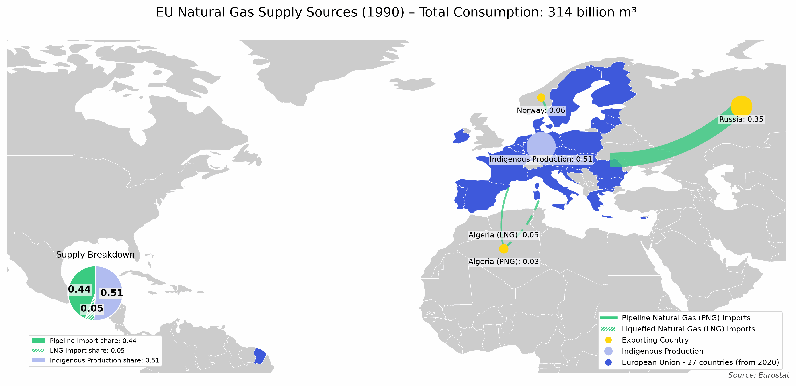

# EU natural gas supply sources

Maps where the EU's natural gas comes from each year since 1990: indigenous production, pipeline imports and LNG imports by origin country, as shares of total consumption. The EU is the 27 member states as of 2020 for every year, so the years are comparable.



## Components

- `loader/` loads the Eurostat import and supply files
- `processor/` computes each year's supply shares by origin and the map coordinates of each exporter
- `writer/` has a JSON writer and a check that the shares add up to 1, not used by the pipeline
- `etl_pipeline.py` runs loader and processor and saves one JSON file with all years
- `trade_flow_visualization_static.py` draws the map for one year
- `create_animation.py` draws every year and combines them into a GIF

## Data

Download these Eurostat datasets as CSV and save them in `data/`:

- `nrg_ti_gas` (imports of natural gas by partner country) as `data/estat_nrg_ti_gas_en.csv`
- `nrg_cb_gas` (supply of natural gas, with indigenous production and inland consumption) as `data/estat_nrg_cb_gas_en.csv`

Only the rows for "European Union - 27 countries (from 2020)" are used. Trade between EU countries is left out, so the map only shows supply from outside the EU. The world map shapes come from Natural Earth, which cartopy downloads on the first run.

## How to run

```bash
pip install -r requirements.txt
python etl_pipeline.py
python trade_flow_visualization_static.py data/eu_gas_flows_1990-2024.json --year 2022
python create_animation.py data/eu_gas_flows_1990-2024.json
```

The JSON file name follows the years Eurostat has data for.
