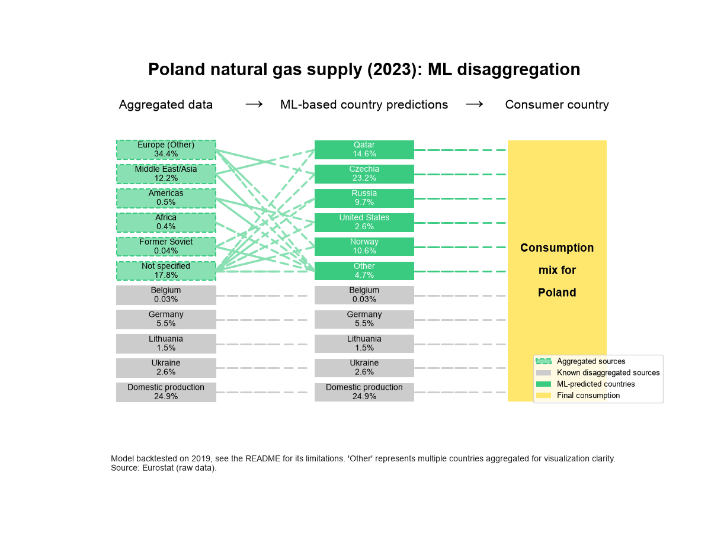
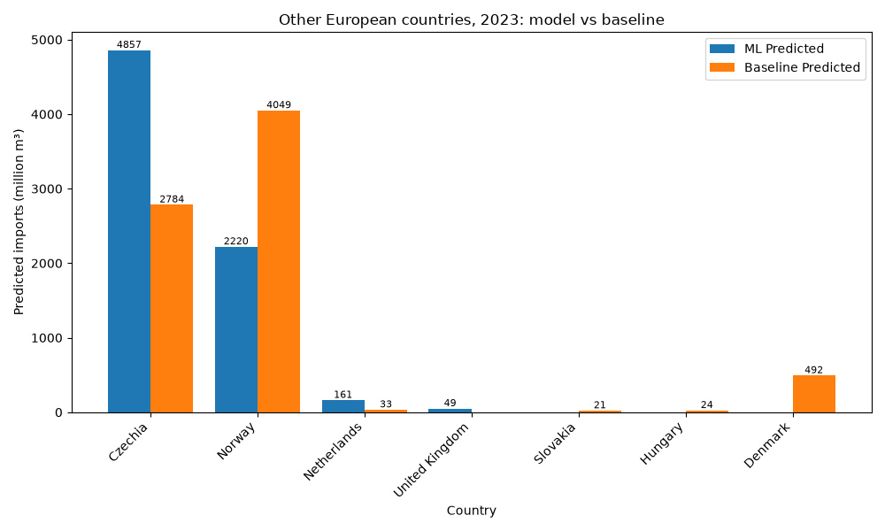

# Poland Gas Trade Disaggregation

## Project Summary

This project reconstructs the country-level breakdown of Poland's 2023 natural gas imports, which are reported as aggregated regions in Eurostat data. It compares a baseline disaggregation from historical import patterns with a random forest model, and backtests the model on earlier years.

## Motivation

In 2023, Poland reported many of its natural gas imports as coming from aggregated regions (e.g., "Other European countries") rather than individual countries, making it difficult to analyze trade flows. This project aims to disaggregate these flows using historical data and predictive modeling.

Knowing the country of origin matters for life cycle assessment, because gas from different countries has very different supply chains, for example pipeline gas from Norway and LNG from Qatar. In Eurostat's gas trade data, "Not specified" shows up for many countries, while the regional "Other ..." groups only appear for Poland in 2023 and 2024.

## Approach

1. **Data Cleaning & Preparation**: Load and clean Eurostat gas trade data, filter for Poland and relevant units/products, and identify aggregated vs. disaggregated partners.
2. **Mapping**: Assign each country that Poland doesn't report separately in 2023 to the regional aggregate of its region, using a fixed country list per region. "Not specified" gets all of these countries, so it overlaps with the regional aggregates.
3. **Baseline Disaggregation**: Use historical country shares to estimate the 2023 breakdown for each aggregate, ensuring the sum matches the reported total.
4. **Visualization**: Visualize the baseline results and compare with previous years to check plausibility and highlight changes in trade structure.
5. **Feature Engineering**: Add the country's import value and share of total imports from the two previous years.
6. **Machine Learning Model**: Train a random forest regressor to predict each country's share within its aggregate. The predicted shares are normalized so they add up to the reported aggregate total. 2022 is left out because the Russian invasion of Ukraine disrupted the trade pattern too much. The model trains on the years up to 2021, and the 2023 prediction uses 2021 and 2020 as the previous years.
7. **Backtest**: Train only on years before a test year (2019 by default), predict the country split of that year as if it were reported as aggregates, and compare with the real country data using MAE, RMSE and R².
8. **Comparison**: Plot the model results next to the baseline for each aggregate.

## Results

Poland's 2023 natural gas supply, with the reported aggregates split into countries by the model:

Model and baseline split of "Other European countries", the largest aggregate. The two methods disagree on the biggest supplier, Czechia for the model and Norway for the baseline. Neither is checked against real data, see Limitations.

## Limitations

- Both methods learn from historical shares, so they can't know about sudden changes. Poland stopped importing Russian gas in 2022, but with Eurostat data downloaded in October 2026 both still give Russia between 2 and 3.3 billion m³ of the 2023 "Not specified" imports.
- The backtest R² of about 0.99 looks better than the model is. Most rows are countries with zero imports, and most aggregates hold only one real supplier, which is easy to predict. The one real test is the 2019 split of "Other European countries" between Czechia and Norway, where the true split is 70/30 and the model predicts 50/49.

## Open Ideas

- Compare the results with the partner countries' reported exports.
- Try other models and features, and refine the country to aggregate mapping.
- Instead of a model, build a trade network graph from the known export and import flows and fill in the missing links from it.

## Repository Structure

- `src/` — Data processing, mapping, modeling, and visualization scripts
- `data/` — Raw and processed data (ignored by git)
- `README.md` — Project summary
- `.gitignore` — Ignore data, logs, and Python artifacts

## How to Run

1. Install the packages with `pip install -r requirements.txt`.
2. Download the Eurostat dataset `nrg_ti_gas` (imports of natural gas by partner country) as CSV and save it as `data/estat_nrg_ti_gas_en.csv`.
   For the GIFs, also download `nrg_cb_gas` (supply of natural gas, which includes Poland's own production) and save it as `data/estat_nrg_cb_gas_en.csv`.
3. Run the scripts in `src/` in this order:
   `data_prep.py`, `prepare_training_data.py`, `generate_aggregate_country_mapping.py`, `baseline_disaggregation.py`, `visualize_baseline.py`, `feature_engineering.py`, `ml_model.py`, `backtest_ml_disaggregation.py`, `evaluate_backtest.py`, `visualize_ml_vs_baseline.py`, `prepare_flow_tables.py`, `visualize_gas_trade_gif.py`, `visualize_gas_trade_sankey_gif.py`.
4. Review the output plots in `data/` and the printed metrics.

