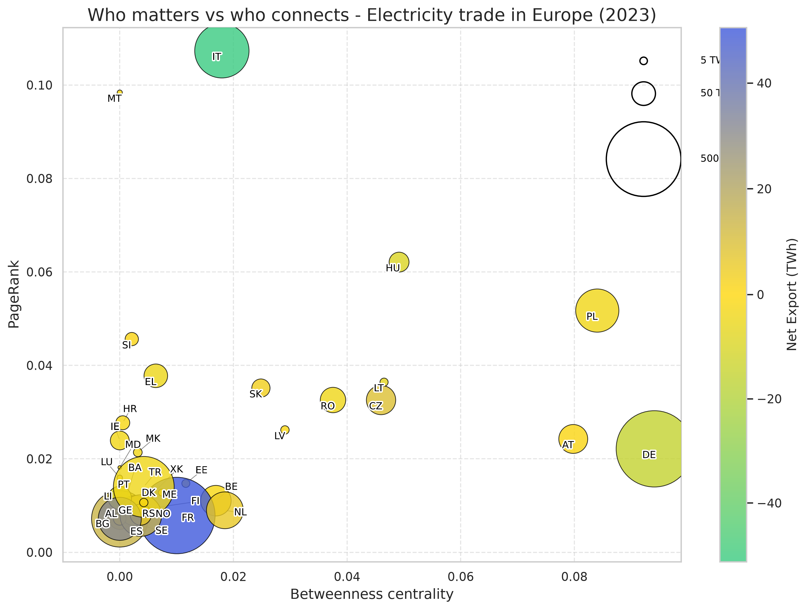

# PageRank of the European electricity trade network

Builds a directed, weighted graph of cross-border electricity flows and ranks countries by PageRank. A country ranks high when a lot of electricity flows into it from countries that rank high themselves. It also computes betweenness centrality and compares network position with domestic generation.



## Data

All inputs come from Eurostat. Download these datasets as CSV and save them in `data/`:

- `nrg_ti_eh` (electricity imports by partner country) as `data/estat_nrg_ti_eh_en.csv`
- `nrg_te_eh` (electricity exports by partner country) as `data/estat_nrg_te_eh_en.csv`
- `nrg_cb_e` (electricity supply, with gross electricity production) as `data/estat_nrg_cb_e_en.csv`

`prepare_eurostat_inputs.py` turns them into the two files the analysis reads:

- a trade file with the columns `exporter`, `importer` and `flow_gwh`, the net annual flow between each pair of countries
- a generation file with the columns `country` and `generation_gwh`

Countries are the 2 letter codes Eurostat uses, so Greece is `EL`. Some countries, like Switzerland and the United Kingdom, don't report to Eurostat. Their flows come from what their neighbours report, and they have no generation value.

## How to run

```bash
pip install pandas networkx scipy matplotlib seaborn adjustText
cd scripts
python prepare_eurostat_inputs.py
python network_pagerank_analysis.py --trade-file ../data/electricity_trade_2023.csv
```
